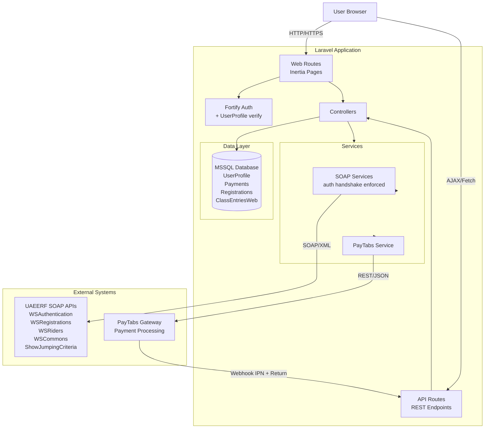
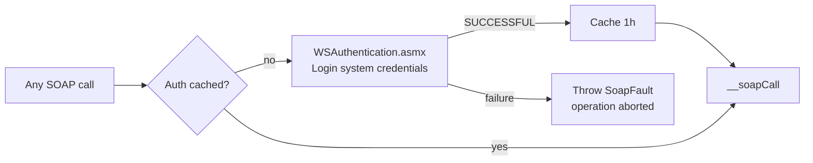
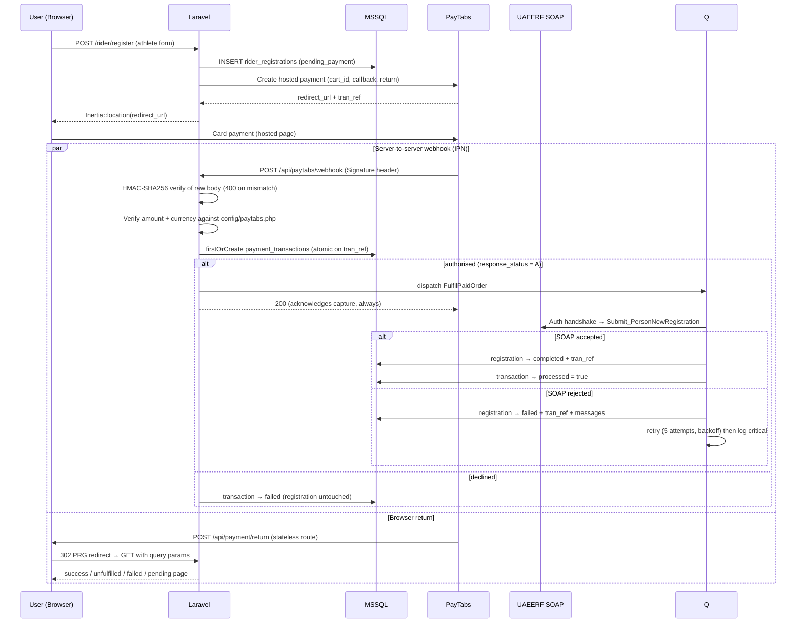
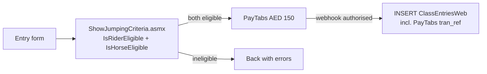

# UAEERF Portal - System Architecture

## Overview

Full-stack equestrian portal integrating MSSQL database, SOAP web services, and PayTabs payment gateway.

**Stack:** Laravel 13 + React 19 + Inertia.js + MSSQL + SOAP + PayTabs

---

## System Architecture



---

## SOAP Authentication Handshake (Evaluation Criterion)

Every SOAP operation passes through `BaseSoapClient::call()`, which enforces a
login against `WSAuthentication.asmx` **before** any other service is invoked
(result cached 1 hour):



| Service class | Endpoint | Purpose |
|---|---|---|
| `AuthenticationService` | WSAuthentication.asmx | System login handshake |
| `CommonsService` | WSCommons.asmx | Cities, countries, genders, disciplines, categories, seasons, visa categories — **cached 24 h** |
| `RegistrationsService` | WSRegistrations.asmx | `Submit_PersonNewRegistration` / `Submit_PersonRenewal` (full WSDL `PersonRegEntries` struct) |
| `RidersService` | WSRiders.asmx | `SearchRiderList` — renewal rider lookup |
| `ShowJumpingCriteriaService` | ShowJumpingCriteria.asmx | `IsRiderEligible` / `IsHorseEligible` |

---

## Payment Flow (webhook is source of truth)



**Critical rules:**

- ✅ Webhook is the source of truth (return URL is display-only)
- ✅ Database completion / SOAP submission ONLY after confirmed payment
- ✅ Signature = HMAC-SHA256 of the **raw request body** with the server key
- ✅ Amount and currency verified against the configured fee before fulfilment
- ✅ Idempotency: `firstOrCreate` on `tran_ref`, atomic against concurrent
  redeliveries
- ✅ Fulfilment runs on the queue; the callback always answers 200 so PayTabs
  never redelivers a payment already recorded
- ✅ `processed` means *fulfilled*, not merely *paid*. A captured payment whose
  federation submission failed stays unprocessed, so it stays findable
- ✅ `cart_id` prefix routes processing: `rider_reg_` / `rider_renewal_` / `jumping_`
- ✅ Return route is **stateless** (API group) so PayTabs' cross-site POST cannot
  rotate the authenticated session cookie. Because it cannot check the session,
  it requires the `tranRef` alongside `cartId` before disclosing a transaction
- ✅ Transaction reference stored with every entry, including failures

**Operational requirement:** fulfilment is queued, so a worker must be running
(`php artisan queue:work`, or the `queue` service under Docker). Without one,
payments are captured and recorded but never submitted to the federation, and
the return page polls indefinitely. Those payments keep `processed = 0`.

Retry semantics distinguish the two failure kinds: a `FederationRejectedException`
(the service understood the request and refused it) fails the job immediately,
because the identical request earns the identical refusal. Transport failures
propagate and are retried with backoff.

### Payment vs fulfilment

These are separate facts and the UI reports them separately — a customer is
never told they are registered when the federation rejected the submission.

| Payment | Fulfilment | Page |
|---|---|---|
| success | completed | `payment.success` — "… Confirmed" |
| success | failed | `payment.unfulfilled` — "Payment Received — … Incomplete" |
| success | pending | `payment.pending` — bounded polling, 20 attempts |
| failed | — | `payment.failed` |

---

## Show Jumping Entry (AED 150)



---

## Identity & Access (Task 1)

- **Registration** — Fortify `CreateNewUser` dual-writes: local `users` row
  (Laravel auth) **and** MSSQL `UserProfile` row.
- **Login** — custom `Fortify::authenticateUsing`: local credential check
  **plus** verification against `UserProfile.Password`. A profile password
  mismatch denies login; MSSQL being unreachable logs an error and degrades
  gracefully (no lockout on infrastructure failure).

---

## Rider Renewal Lookup (Task 3 "Query rider")

`GET /api/riders/search?q=` (authenticated, validated) → `RidersService::searchRiders()`
→ `SearchRiderList` on WSRiders.asmx → mapped to
`{rider_id, name, dob, nationality, registered_current_season}`.
The renewal page uses a debounced type-ahead; real federation rider IDs
(`E00xxxxx`, nvarchar) flow through to `Submit_PersonRenewal.PersonID`.

---

## Security Features

- Webhook signature verification (HMAC-SHA256, raw body)
- Idempotency checks (duplicate webhook prevention)
- Rate limiting (10 req/min on payment initiation endpoints)
- Payment-before-database-write flow
- SOAP system credentials via environment only (never hardcoded)
- Session-safe stateless payment return route
- Mass-assignment protection, LIKE-wildcard escaping, no `dangerouslySetInnerHTML`

---

## API Endpoints

### Public
```
GET  /api/commons/*             # Cached SOAP lists (cities, countries, genders, ...)
```

### Protected (auth)
```
POST /rider/register            # Registration → PayTabs (AED 100)
POST /rider/renew               # Renewal → PayTabs (AED 50)
POST /jumping/validate          # Eligibility check (AJAX)
POST /jumping/entry             # Entry → PayTabs (AED 150)
GET  /api/riders/search?q=      # Rider lookup for renewals
```

### Payment (no auth — verified by signature / display-only)
```
POST     /api/paytabs/webhook   # PayTabs IPN (HMAC verified)
GET|POST /api/payment/return    # User return URL (stateless, PRG)
```

---

## Testing

98 automated tests (Pest) covering registration validation, payment webhook
security (signature, amount/currency verification, atomic idempotency,
malformed and unknown-cart payloads, declined/authorised paths, SOAP
success/rejection for registrations **and** renewals), payment/fulfilment
return pages and their information-disclosure guard, unfulfilled-payment
recovery, SOAP log redaction, rider search, and federation-verified login and
registration. Both MSSQL connections are faked as in-memory SQLite per test —
the suite runs with no external dependencies.

---

## Known Environment Limitation

`Submit_PersonNewRegistration` accepts a `UserId` only if it appears in the
**53-account whitelist** returned by `Get_DEC_UserList`. Every other value —
including ids present in `eefsys.WebUserProfile`, and id `6422` which has real
rows in `eefsys.Registration` — returns `Invalid User ID`. All other field
validation passes.

Ruled out by direct probing: sending the local `users.id` (wrong, and fixed),
creating the profile in `eefsys.WebUserProfile`, setting
`Stable_ID` + `IsStableAuthorized = 1`, and propagating the
`EEFWSAuthentication` session cookie. The service validates against a user
store this login cannot reach, consistent with the brief's reference to
`WEBSQL.EEFRegistration` — a different server from the `EEF` database the
assessment credentials open.

**A self-registered account therefore cannot complete a rider registration.**
Demonstrating the flow end-to-end requires one of the whitelisted ids. The
service's rejection messages are captured verbatim in
`rider_registrations.error_message`, and the customer sees the
payment-received-but-incomplete page rather than a false success.

Two further environment faults, both worked around — see
[FEDERATION-INTEGRATION.md](FEDERATION-INTEGRATION.md):

- `WSHorses.SearchHorseListV5` never responds within 120 s → horses read from
  `eefsys.HorseMaster`.
- `WSRiders.SearchRiderList`'s `SearchStable` returns nothing for any value →
  riders read from `eefsys.VIEW_Registrations_WithUserID`.

Deferred by scope: profile-photo upload (`Submit_Document`).

---

**Built for:** UAEERF Technical Assessment
